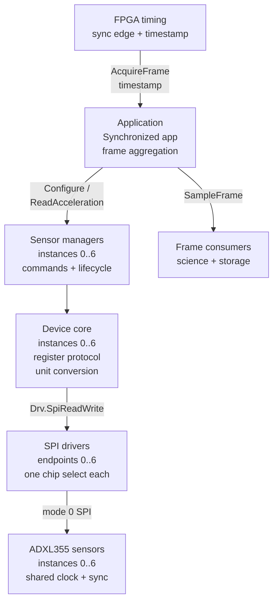
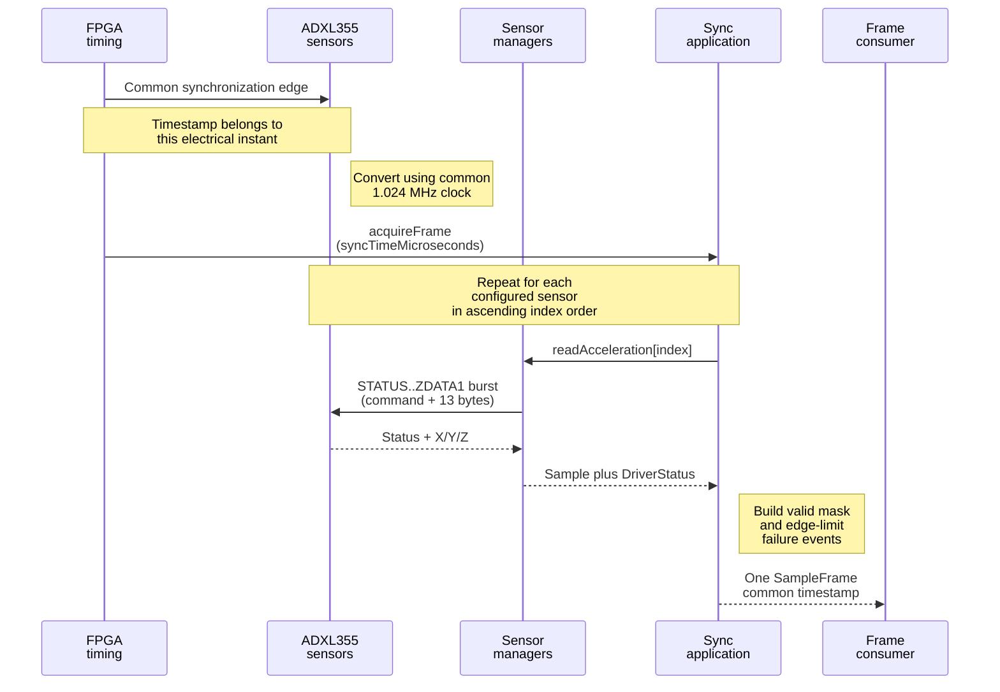
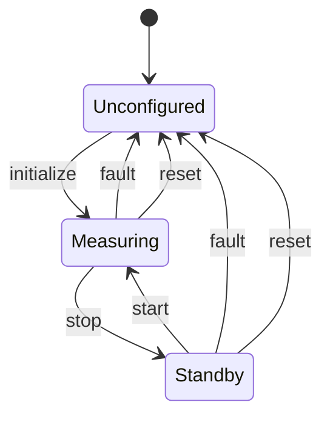

# Architecture and design

## Application-manager-driver split

The implementation deliberately separates mission behavior, device semantics, and bus access.

| Layer | Implementation | Responsibility |
| --- | --- | --- |
| Application | `Adxl355.SynchronizedApplication` | Initialize the configured sensor set, react to one FPGA timing instant, read managers in a fixed order, and publish one frame |
| Manager | Seven `Adxl355.Manager` instances | Own one ADXL355 lifecycle, expose commands/telemetry/events, and translate FPP types to the device core |
| Driver | Seven generic SPI endpoints | Select the correct chip and perform a full-duplex byte transfer without knowing ADXL355 registers |
| Hardware-independent core | `Adxl355::Device` | Encode registers, validate configuration, perform reset/readback, check freshness, decode samples, and convert units |

This is the F Prime application-manager-driver pattern: the SPI driver remains reusable and device agnostic, while ADXL355 behavior stays above it. The standard `Drv.SpiReadWrite` port is the hardware boundary.

## Synchronized acquisition

The FPGA is the timing authority. It distributes the same 1.024 MHz clock and 4 kHz synchronization pulse to all sensors, then invokes `AcquireFrame` with the time of that synchronization instant. The application calls the seven synchronous `readAcceleration` ports sequentially.

Sequential bus access changes only when the already-converted result is fetched. It does not change the ADC sampling instant. Each acquisition read is one command byte plus a 13-byte burst from `STATUS` (0x04) through `ZDATA1` (0x10). The data sheet (Rev. D, "Reading acceleration or temperature data") guarantees that X, Y, and Z belong to one data set when the transfer starts after `DATA_RDY` and completes within about one output period; triggering on the synchronization edge and finishing all seven reads inside the 250 microsecond period satisfies that condition.

A `SampleFrame` contains:

- a monotonic sequence that advances on every enabled trigger, so a skipped trigger appears as a gap;
- the FPGA-provided synchronization timestamp;
- the configured sensor count;
- seven fixed-capacity acceleration slots;
- a valid bit per sensor; and
- a status per sensor.

One failed read therefore produces a partial frame instead of hiding the other six samples. Incomplete-frame events are emitted only when the valid mask changes, recovery is also edge-reported, and both events are throttled so an intermittent sensor cannot flood the event stream. The high-rate data path emits no per-sample telemetry.

### Freshness and plausibility

The F Prime 3.5.1 `Drv.SpiReadWrite` port returns no status, so the library cannot learn from the transport that a transfer failed. It instead checks the bytes it receives, using properties the data sheet guarantees:

| Condition | Evidence in the burst | Status |
| --- | --- | --- |
| No sample newer than the previous status read (stopped external clock, sensor not converting, read faster than ODR) | `DATA_RDY` clear; the data sheet clears it on every STATUS read and sets it only for newer data | `STALE_DATA` |
| Bytes that cannot come from an ADXL355 (floating or stuck-high MISO) | STATUS bits 7:5, documented to read 0, are set | `IMPLAUSIBLE_DATA` |
| MISO stuck low or chip select not asserted | All bytes zero, so `DATA_RDY` is clear | `STALE_DATA` |

With `EXT_SYNC = 01` and `EXT_CLK = 1`, the data sheet states that a missing external clock stops all data processing and the output reads as null values. Before this check, that condition produced frames full of zero acceleration marked valid. Loss of the synchronization pulse alone is not detectable here: the device keeps running synchronized to the last pulse it received, so the FPGA timing path must monitor the pulse train.

Reading STATUS also clears `FIFO_OVR` and the activity bit. The default direct-read path never drains the stream-mode FIFO, so `FIFO_OVR` is expected to be set and is not treated as a fault; `StatusRegister` telemetry reports the last observed byte for diagnosis.

## Execution context

Both F Prime components are passive, and their handlers run on the calling thread. In a deployment the FPGA timing task calls `acquireFrame`, and the command dispatcher calls every command handler, so two threads reach the same objects. A per-component `AccessGate` (a lock-free `std::atomic<bool>` owner flag) serializes them without letting the acquisition path wait.

| Caller | Thread | Gate behavior | Worst-case hold or wait |
| --- | --- | --- | --- |
| `SynchronizedApplication.acquireFrame` | Timing task | Try once; if a command or an overlapping trigger owns the gate, skip the trigger and count it in `SkippedTriggers` | Holds the application gate for one frame (budget below 250 microseconds) |
| `Manager.readAcceleration` | Timing task, through the application | Try once; return `BUSY` for that sensor only | Holds the manager gate for one 14-byte transfer |
| Every other manager port and command | Dispatcher or client | Wait at most 10 attempts, 1 ms apart, then return `BUSY` / `EXECUTION_ERROR` and emit `ControlBusy` | 9 ms wait; hold time listed below |
| Application commands | Dispatcher | `INITIALIZE_ALL`, `INITIALIZE_ALL_INTERNAL`, and `SET_SENSOR_COUNT` are rejected while acquisition is enabled; other commands wait as above | `REPORT` never takes the gate; `CLEAR_EVENT_THROTTLE` defers to the next frame while enabled |

Consequences an integrator must plan for:

- A manager command sent during science acquisition costs that sensor the frames it overlaps, reported as `BUSY` in `sensorStatus`; it never stalls the other sensors. `READ_SNAPSHOT` holds the gate for three short transfers and never reads STATUS, so it cannot consume the acquisition path's `DATA_RDY`.
- Initialization blocks the calling thread. One sensor normally takes a few milliseconds; the bound is `MAX_RESET_ATTEMPTS` (3) resets, each waiting up to 256 ms for `NVM_BUSY`, which is about 0.77 s. `INITIALIZE_ALL` for seven sensors is therefore bounded at about 5.4 s on the command dispatcher thread. Size health-ping timeouts for that bound, or route initialization through an active component.
- The same caller stack holds the frame plus the SPI buffers. Transfers of up to 16 data bytes use 17-byte buffers; only a full FIFO read uses the 289-byte pair. Include this depth when sizing the timing task stack; the library performs no heap allocation in these paths.

At 4 kHz the period is 250 microseconds. Seven 14-byte (112-bit) status-checked transactions require 78.4 microseconds at 10 MHz or 156.8 microseconds at 5 MHz, before chip-select gaps and software overhead. The four status bytes add 22.4 microseconds per frame at 10 MHz; that is the price of detecting stale and implausible data without a status-bearing transport. A Zynq/FPGA-backed real-time SPI implementation is preferable to Linux userspace when hard timing guarantees matter.

## Device state and safety

Initialization performs the following sequence:

1. validate configuration without bus traffic;
2. read and validate `DEVID_AD`, `DEVID_MST`, and `PARTID`;
3. before the first software reset, capture the factory-trim shadow registers 0x50 through 0x54;
4. issue the `0x52` software reset and wait for `NVM_BUSY` to clear with a bounded timeout;
5. compare the shadow registers with the reference and repeat the reset, up to three times, until they match;
6. enter standby and program filter, range, FIFO watermark, interrupt map, synchronization, and power policy;
7. read back the writable configuration; and
8. enter measurement mode.

Steps 3 and 5 follow the data sheet (Rev. D, Reset register): on parts with `REVID` 0x01 or earlier a software reset can load NVM trim incorrectly and corrupt the 0 g bias, and a power cycle cannot be assumed. The reference is only valid if it is captured before any software reset since the sensor was powered; after a flight-software restart without a sensor power cycle, a previous instance may already have reset the device.

`Device` holds exactly one `LifecycleState`: `UNCONFIGURED`, `STANDBY`, or `MEASURING`. There are no independent flags whose combinations could create an undiagrammed state. The transitions are:

- `initialize` is all or nothing. Validation or identity failures perform no writes and leave the state unchanged; once the reset has been issued, any failure leaves `UNCONFIGURED`.
- `start` is accepted only from `STANDBY` or `MEASURING`. A transport failure leaves the state unchanged; a readback failure leaves `UNCONFIGURED`.
- `stop` is accepted from every state because standby is the safe state.
- "fault" is any failed readback during a runtime control, any failed self-test write, or a diagnostic `writeRegister`, after which the software can no longer vouch for the register set.

Controls that the data sheet requires to change in standby stop measurement, perform and verify the update, and resume only after success. The data sheet allows only `HPF_CORNER`, `INT_MAP`, `ST1`/`ST2`, and reset to change while measuring. `setSelfTest` therefore does not enter standby. `configureInterrupts` does, because interrupt polarity lives in the range register. Self-test bits are tracked and published as `SelfTest` telemetry, and a reset clears them.

## Error containment

- Configuration conflicts and invalid enum/range values are rejected before I/O. The data sheet (Table 14) marks `EXT_SYNC = 01` without `EXT_CLK` as not recommended because it resets the digital filters on every pulse, so the library rejects it. An `INT2` interrupt mapping is also rejected while `INT2` carries the external clock.
- Each sensor has its own status in an aggregate frame.
- Manager read failures are counted on every occurrence but evented only on an error edge, and the event is throttled (10) until `CLEAR_EVENT_THROTTLE` or a successful initialization.
- The application reports changes in valid masks and full-array recovery, both throttled (10).
- Rejected arguments and out-of-sequence commands are reported by the command response only; they do not increment the device error counter or raise high-severity warnings.
- Temperature is read until two consecutive reads agree, because TEMP2/TEMP1 are not double buffered.
- No dynamic allocation is used in the core or frame aggregation path.
- Internal impossibilities use `ADXL355_ASSERT`, which the F Prime build maps to `FW_ASSERT` so the deployment's assertion hook defines the response. Examples are an unmapped status value, a sensor count outside 1 through 7 on the frame path, and an out-of-range stored range. Bus, ground, and configuration input is never asserted.

The F Prime 3.5.1 `Drv.SpiReadWrite` port has no return status. A disconnected manager port is detected, protocol and readback failures are reported, and stale or implausible bus data is rejected as described above. An underlying Linux `ioctl` failure still cannot be returned through this standard port; the generic driver emits its own error event. A flight platform that requires per-transfer propagation should provide a status-bearing SPI adapter.

## Engineering-practice evidence

The architecture is assessed against the workshop-derived criteria in the [ADXL355 practice audit](practices-audit.md), with stable behavior and verification mappings in [Requirements and verification](requirements-and-verification.md). The executed results, including coverage for both the core and the F Prime components, are retained in `docs/evidence/` and pinned to the exact sources by `source-sha256.json`. The remaining closures are flight-target timing, electrical captures, and HIL fault injection.
