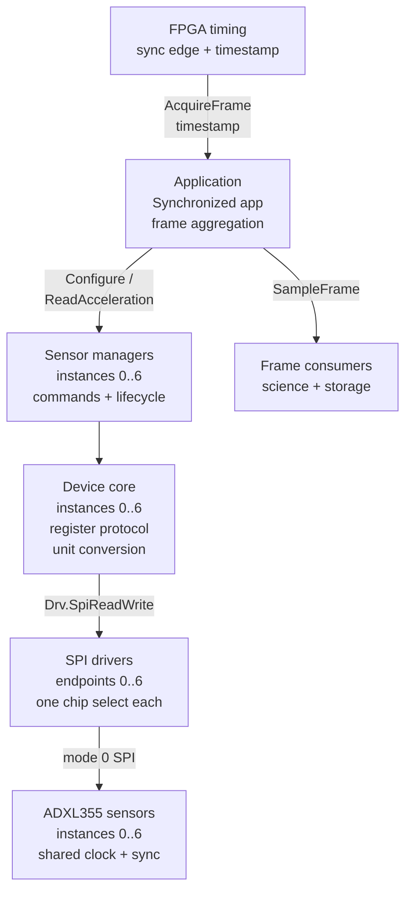
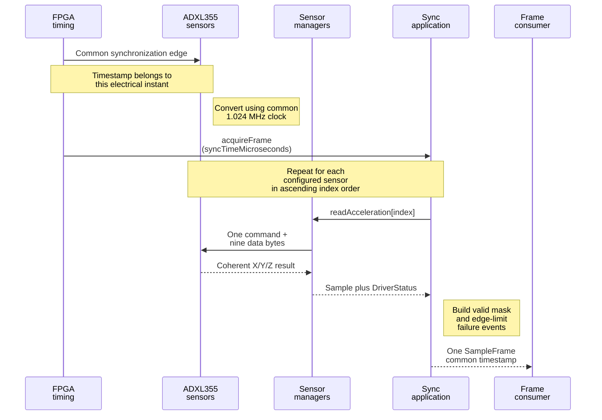
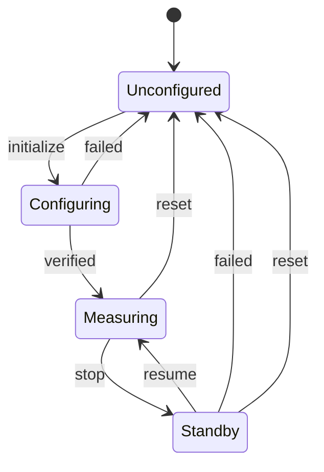

# Architecture and design

## Application-manager-driver split

The implementation deliberately separates mission behavior, device semantics, and bus access.

| Layer | Implementation | Responsibility |
| --- | --- | --- |
| Application | `Adxl355.SynchronizedApplication` | Initialize the configured sensor set, react to one FPGA timing instant, read managers in a fixed order, and publish one frame |
| Manager | Seven `Adxl355.Manager` instances | Own one ADXL355 state machine, expose commands/telemetry/events, and translate FPP types to the device core |
| Driver | Seven generic SPI endpoints | Select the correct chip and perform a full-duplex byte transfer without knowing ADXL355 registers |
| Hardware-independent core | `Adxl355::Device` | Encode registers, validate configuration, perform reset/readback, decode samples, and convert units |

This is the F Prime application-manager-driver pattern: the SPI driver remains reusable and device agnostic, while ADXL355 behavior stays above it. The standard `Drv.SpiReadWrite` port is the hardware boundary.

## Synchronized acquisition

The FPGA is the timing authority. It distributes the same 1.024 MHz clock and 4 kHz synchronization pulse to all sensors, then invokes `AcquireFrame` with the time of that synchronization instant. The application calls the seven synchronous `readAcceleration` ports sequentially.

Sequential bus access changes only when the already-converted result is fetched. It does not change the ADC sampling instant. Each direct read is one command byte plus the nine contiguous X/Y/Z bytes, which also keeps the three axes from one sensor coherent.

A `SampleFrame` contains:

- a monotonic frame sequence;
- the FPGA-provided synchronization timestamp;
- the configured sensor count;
- seven fixed-capacity acceleration slots;
- a valid bit per sensor; and
- a status per sensor.

One failed read therefore produces a partial frame instead of hiding the other six samples. Incomplete-frame events are emitted only when the valid mask changes; recovery is also edge-reported. The high-rate data path emits no per-sample telemetry.

## Component execution model

Both F Prime components are passive. Acquisition executes synchronously in the thread that invokes `acquireFrame`, so the deployment owns scheduling priority and timing determinism. Do not invoke a manager concurrently from the acquisition path and a second thread. If commands can race with acquisition, serialize them in the deployment or place the application behind a single active executor.

The same caller stack holds the fixed frame plus the SPI transmit/receive buffers (up to 289 bytes each for a maximum FIFO burst). Include this call depth when sizing the FPGA timing task's stack; the library performs no heap allocation in this path.

At 4 kHz the period is 250 microseconds. Seven 80-bit direct-read transactions require 56 microseconds at 10 MHz or 112 microseconds at 5 MHz, before chip-select gaps and software overhead. A Zynq/FPGA-backed real-time SPI implementation is preferable to Linux userspace when hard timing guarantees matter.

## Device state and safety

Initialization performs the following sequence:

1. validate configuration without bus traffic;
2. read and validate `DEVID_AD`, `DEVID_MST`, and `PARTID`;
3. issue the `0x52` software reset;
4. wait for `NVM_BUSY` to clear with a bounded timeout;
5. enter standby and program filter, range, FIFO watermark, interrupt map, synchronization, and power policy;
6. read back the writable configuration; and
7. enter measurement mode.

The code represents these states with three initialized Boolean invariants because the lifecycle is small. `measuring` implies `configured`, and successful initialization implies both `initialized` and `configured`. If future work adds independent modes or asynchronous transitions, replace the flags with a formal state model rather than allowing combinations to grow implicitly.

Controls that the data sheet requires to change in standby stop measurement, perform and verify the update, and resume only after success. Once programming has begun, any failed reconfiguration invalidates the configured state and prevents a partially programmed device from being restarted.

## Error containment

- Configuration conflicts and invalid enum/range values are rejected before I/O.
- Each sensor has its own status in an aggregate frame.
- Manager read failures are counted on every occurrence but evented only on an error edge, preventing 4 kHz event floods.
- The application reports changes in valid masks and full-array recovery.
- No dynamic allocation is used in the core or frame aggregation path.

The F Prime 3.5.1 `Drv.SpiReadWrite` port has no return status. A disconnected manager port is detected, and protocol/readback failures are reported, but an underlying Linux `ioctl` failure cannot be returned through this standard port. The generic driver still emits its own error event. A flight platform that requires per-transfer propagation should provide a status-bearing SPI adapter or extend the standard boundary consistently across the deployment.

## Engineering-practice evidence

The architecture is assessed against the workshop-derived criteria in the [ADXL355 practice audit](practices-audit.md), with stable behavior and verification mappings in [Requirements and verification](requirements-and-verification.md). The host core currently meets the 80% production line-coverage gate. The most important remaining closures are deployment concurrency analysis, status propagation at the concrete SPI boundary, local static-analysis execution (or a retained successful CI report), and flight-target HIL timing.
