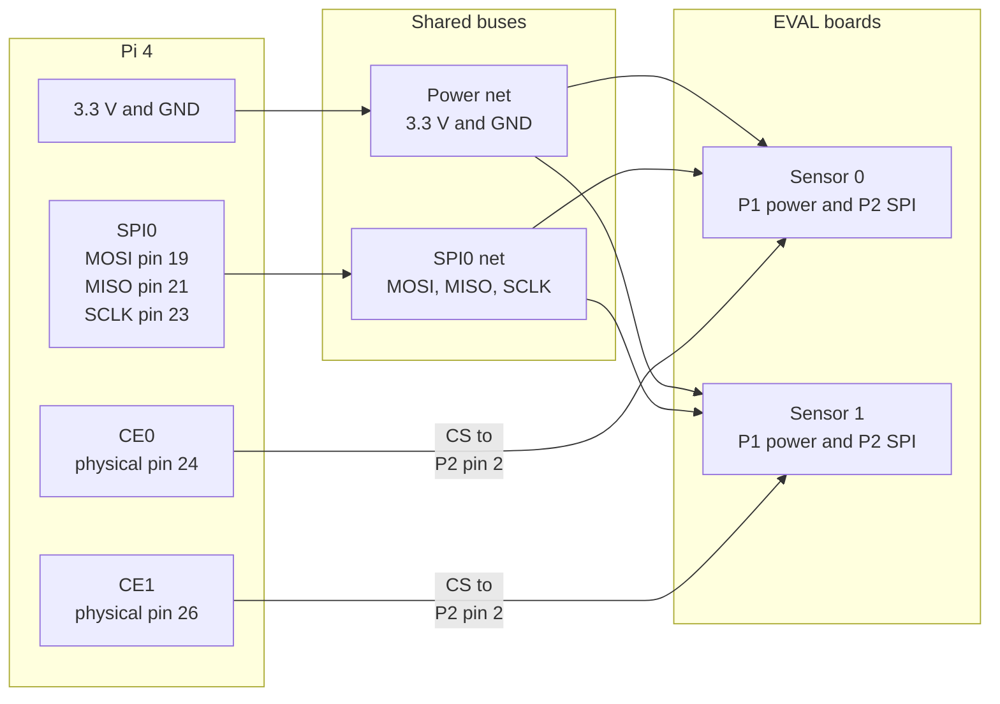

# Raspberry Pi 4 and EVAL-ADXL355Z bench example

This example connects one or two Analog Devices EVAL-ADXL355Z boards to SPI0 on a Raspberry Pi 4. It exercises the real F Prime path:

```text
SynchronizedApplication
        |
        | Adxl355.Configure / Adxl355.ReadAcceleration
        v
Manager (one per sensor)
        |
        | Drv.SpiReadWrite
        v
Drv.LinuxSpiDriver (one per chip select)
        |
        v
/dev/spidev0.0 or /dev/spidev0.1
```

The first bring-up uses each sensor's internal clock. That verifies power, SPI, identity, configuration, conversion, events, telemetry, and two-chip-select fan-out. It does **not** prove that two samples were taken simultaneously. The final section explains what changes for externally synchronized testing.



The diagram shows topology, not a substitute for the pin-by-pin tables below. With one board, omit sensor 1 and CE1.

## Hardware and safety

You need:

- a Raspberry Pi 4 with its normal power supply and Raspberry Pi OS;
- one or two EVAL-ADXL355Z boards;
- short 2.54 mm jumper wires or a small breadboard; and
- two 2 x 3, 2.54 mm headers if P1 and P2 are unpopulated.

The EVAL-ADXL355Z BOM marks P1 and P2 as unpopulated, so inspect your board before starting. The board has no reverse-polarity protection. Disconnect Raspberry Pi power while changing wiring and use normal ESD precautions.

!!! danger "3.3 V only"
    Power both `VDD` and `VDDIO` from the Raspberry Pi 3.3 V rail. Never connect Raspberry Pi 5 V to the EVAL-ADXL355Z or to any ADXL355 signal.

The current ADXL355 data sheet defines device pin 7 as reserved and permits it to be grounded or left open. The evaluation board may label its three-pin jumper `STBY`; remove that jumper for this test. Software standby is controlled through the `POWER_CTL` register.

Sources: [EVAL-ADXL354/EVAL-ADXL355 User Guide UG-1030](https://www.analog.com/media/en/technical-documentation/user-guides/EVAL-ADXL354-355-UG-1030.pdf) and [ADXL354/ADXL355 data sheet](https://www.analog.com/media/en/technical-documentation/data-sheets/adxl354_adxl355.pdf).

## Identify the evaluation-board pins

P1 and P2 are 2 x 3 footprints. In the official function-block diagrams, the odd-numbered column is pins 1, 3, and 5 and the even-numbered column is pins 2, 4, and 6. Work by the connector designator and pin number; do not infer the pin from a rotated photograph. Confirm pin 1 from the PCB marking or square pad before applying power.

| P1 pin | Signal | Initial bench use |
| --- | --- | --- |
| P1 pin 1 | `VDDIO` | Connect to 3.3 V |
| P1 pin 2 | `INT1` | Leave open |
| P1 pin 3 | `VDD` / `VSUPPLY` | Connect to 3.3 V |
| P1 pin 4 | `INT2` | Leave open; external clock input later |
| P1 pin 5 | `VSS/VSSIO` | Connect to Raspberry Pi ground |
| P1 pin 6 | `DRDY` | Leave open; data-ready output in internal mode |

| P2 pin | Signal | Initial bench use |
| --- | --- | --- |
| P2 pin 1 | `V1P8ANA` | Leave open; internal LDO rail |
| P2 pin 2 | `CS/SCL` | Connect to the sensor's dedicated chip select |
| P2 pin 3 | `V1P8DIG` | Leave open; internal LDO rail |
| P2 pin 4 | `SCLK/VSSIO` | Connect to SPI0 SCLK |
| P2 pin 5 | `MISO/ASEL` | Connect to SPI0 MISO |
| P2 pin 6 | `MOSI/SDA` | Connect to SPI0 MOSI |

Do not apply power to `V1P8ANA` or `V1P8DIG` in this setup. Supplying 3.3 V to P1 `VDD` enables the ADXL355 internal regulators; P2 pins 1 and 3 are then regulator rails, not Raspberry Pi power inputs.

## Wire one sensor

Use physical header pin numbers for the Raspberry Pi column. BCM GPIO numbers are included only as a cross-check.

| Raspberry Pi 4 | Function | EVAL-ADXL355Z sensor 0 |
| --- | --- | --- |
| physical pin 1, 3.3 V | Power | P1 pin 1 `VDDIO` and P1 pin 3 `VDD` |
| physical pin 6, GND | Ground | P1 pin 5 `VSS/VSSIO` |
| physical pin 19, GPIO10 | SPI0 MOSI | P2 pin 6 `MOSI/SDA` |
| physical pin 21, GPIO9 | SPI0 MISO | P2 pin 5 `MISO/ASEL` |
| physical pin 23, GPIO11 | SPI0 SCLK | P2 pin 4 `SCLK/VSSIO` |
| physical pin 24, GPIO8 | SPI0 CE0 | P2 pin 2 `CS/SCL` |

Use a breadboard rail or a small splitter to distribute 3.3 V to both P1 supply pins. Keep SCLK, MOSI, MISO, chip-select, and ground wires short. Do not connect P1 pin 6 `DRDY` for the first polling test.

## Wire a second sensor

Connect sensor 1 power, ground, MOSI, MISO, and SCLK in parallel with sensor 0. Give it a separate chip select:

| Raspberry Pi 4 | EVAL-ADXL355Z sensor 1 |
| --- | --- |
| physical pin 1, 3.3 V | P1 pin 1 `VDDIO` and P1 pin 3 `VDD` |
| physical pin 6, GND | P1 pin 5 `VSS/VSSIO` |
| physical pin 19, GPIO10 / SPI0 MOSI | P2 pin 6 `MOSI/SDA` |
| physical pin 21, GPIO9 / SPI0 MISO | P2 pin 5 `MISO/ASEL` |
| physical pin 23, GPIO11 / SPI0 SCLK | P2 pin 4 `SCLK/VSSIO` |
| physical pin 26, GPIO7 / SPI0 CE1 | P2 pin 2 `CS/SCL` |

Do not connect the two chip-select signals together. In internal timing mode, `DRDY` is an output, so do not connect the two P1 pin 6 signals together either.

The resulting Linux endpoints are:

| Sensor | Chip select | Device node |
| --- | --- | --- |
| 0 | SPI0 CE0 | `/dev/spidev0.0` |
| 1 | SPI0 CE1 | `/dev/spidev0.1` |

The Raspberry Pi SPI pin assignments and 3.3 V GPIO levels are documented in the [Raspberry Pi hardware documentation](https://www.raspberrypi.com/documentation/computers/raspberry-pi.html#gpio-and-the-40-pin-header).

## Enable and verify SPI0

On Raspberry Pi OS, enable SPI and reboot:

```sh
sudo raspi-config nonint do_spi 0
sudo reboot
```

After reconnecting:

```sh
ls -l /dev/spidev0.0 /dev/spidev0.1
```

Both nodes should exist even when only CE0 is wired. Raspberry Pi OS implements this setting as `dtparam=spi=on` in `/boot/firmware/config.txt`; SPI0 exposes two chip selects by default. See the official [SPI configuration documentation](https://www.raspberrypi.com/documentation/computers/raspberry-pi.html#spi-software).

Do not run the flight application as root merely to bypass device permissions. Give the deployment user access to the SPI device according to the Raspberry Pi OS group and udev policy, then log out and back in if group membership changes.

## Add the F Prime topology fragments

The copyable files are under `examples/RaspberryPi4`:

- `instances.fpp` defines one application, two managers, and two `Drv.LinuxSpiDriver` instances. Its initialization phases open bus 0, selects 0 and 1, in SPI mode 0 at 10 MHz.
- `topology.fpp` contains the application-manager-driver connections.
- `README.md` explains what the enclosing deployment must supply.

Merge those fragments into a normal Linux F Prime deployment, allocate nonoverlapping base IDs, and apply its standard command, event, telemetry, text-event, and time connection patterns. If only one sensor is installed, it is safe to leave the second physical connection unused, but opening `/dev/spidev0.1` still must succeed because the example instantiates that driver.

For long jumper wires or early signal-integrity troubleshooting, change `SPI_FREQUENCY_10MHZ` to `SPI_FREQUENCY_5MHZ` or `SPI_FREQUENCY_1MHZ`. Keep mode `SPI_MODE_CPOL_LOW_CPHA_LOW`.

## Internal-clock smoke test

Start the deployment and connect the F Prime GDS. Use the instance-qualified commands shown by the GDS.

For one sensor:

1. Send `adxl355App.SET_ENABLED(false)`.
2. Send `adxl355App.SET_SENSOR_COUNT(1)`.
3. Send `adxl355App.INITIALIZE_ALL_INTERNAL(G2, HZ_125, OFF)`.
4. Confirm an `ArrayInitializationComplete` event and `InitializedMask == 0x01`.
5. Send `adxl355Manager0.READ_SNAPSHOT` several times while changing board orientation.
6. Confirm the acceleration channels change, one stationary axis is approximately +/-9.81 m/s^2, and `LastStatus == OK`.

For two sensors, repeat with `SET_SENSOR_COUNT(2)`. A successful initialization produces `InitializedMask == 0x03`. Send `READ_SNAPSHOT` to both managers and confirm each responds independently. Disconnecting one CS should cause only that manager to fail.

`INITIALIZE_ALL_INTERNAL` intentionally uses the sensor's internal oscillator and requires no wiring to INT2 or DRDY. Manual `READ_SNAPSHOT` calls are low-rate diagnostics; they are not the 4 kHz science-data path.

## Externally synchronized two-sensor test

External synchronization needs a 3.3 V timing source in addition to the Raspberry Pi. A Digital Discovery, FPGA, or other hardware pattern generator is appropriate. Ordinary Linux userspace GPIO toggling is not a deterministic timing reference.

With all equipment powered down:

1. Connect timing-source ground to the Raspberry Pi and both sensor grounds.
2. Connect one 1.024 MHz, 3.3 V clock output to P1 pin 4 `INT2` on both sensors.
3. Connect one 4 kHz, 3.3 V synchronization output to P1 pin 6 `DRDY/SYNC` on both sensors.
4. Keep the SPI and separate-CS wiring unchanged.

Configure the generator so the synchronization pulse is at least 3.91 microseconds wide and meets the data-sheet setup requirement relative to the external clock. Start and stabilize the 1.024 MHz clock before sensor initialization.

Then:

1. Send `SET_ENABLED(false)` and `SET_SENSOR_COUNT(2)` to the application.
2. Send `INITIALIZE_ALL(G2, HZ_4000, OFF)`. This is the external-clock, no-interpolation flight preset.
3. Confirm `InitializedMask == 0x03`.
4. Start the 4 kHz synchronization pulses.
5. Enable the deployment timing component that invokes `acquireFrame` after the corresponding result is available, while passing the timestamp of that synchronization edge.
6. Send `SET_ENABLED(true)` and verify frames have `validMask == 0x03`.

The synchronized application must be triggered from the timing source associated with the electrical sync edge, after allowing for the sensor's fixed processing delay. The `syncTimeMicroseconds` argument records the sampling/synchronization instant, not the later SPI-read time. A free-running Linux timer can exercise the code path, but its timestamp does not prove sensor phase alignment.

## Troubleshooting

| Symptom | Likely cause and check |
| --- | --- |
| SPI open event for select 0 or 1 | SPI is disabled, the expected `/dev/spidev0.x` node is absent, or the process lacks permission |
| `IDENTITY_MISMATCH` | MOSI/MISO are crossed, CS is on the wrong board pin, the board is in I2C wiring, or power/ground is wrong |
| Linux SPI write event or readback verification failure | Check common ground, shorten wires, lower SPI frequency, and capture mode-0 signaling |
| Correct identity but constant or zero acceleration | Confirm internal initialization was used; external mode without the 1.024 MHz clock produces no processed data |
| Sensor 0 works but sensor 1 fails | Verify CE1 physical pin 26 reaches only sensor 1 P2 pin 2 and `/dev/spidev0.1` exists |
| Two internal-mode sensors appear phase shifted | Expected: internal oscillators are independent; use the external-clock/sync wiring for coherence |

Use a logic analyzer to confirm SCLK idles low, only one CS is low at a time, each acquisition read contains one command byte (0x09) followed by thirteen status/data bytes, and each `READ_SNAPSHOT` sample read contains one command byte (0x11) followed by nine data bytes.
