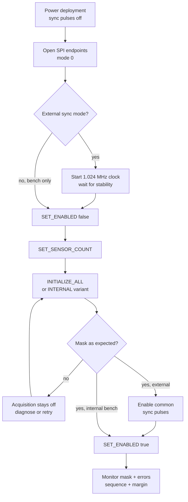

# Setup and examples

## Add the library to an F Prime project

Place or reference `libraries/fprime-adxl355` outside the consuming project root, then add it to `settings.ini`. The workspace LED tutorial uses:

```ini
[fprime]
project_root: .
framework_path: ./fprime
library_locations: ../../../libraries/fprime-adxl355
```

The library's `library.cmake` registers all five targets. Regenerate the build after changing FPP or library locations:

```sh
fprime-util generate --ut
fprime-util build
```

The CubeSpec `sandbox/tutorials/led-blinker/settings.ini` already contains this registration. Consumers outside this workspace should use the relative or absolute path appropriate to their checkout.

For Raspberry Pi 4 wiring, SPI0 setup, one- and two-board command sequences, and external synchronization, follow the [Raspberry Pi 4 bench example](raspberry-pi-4.md). Its copyable FPP fragments are in `examples/RaspberryPi4`.

## Deployment topology

Instantiate one application, seven managers, and seven generic SPI-driver endpoints. Connect both application output arrays by matching index:

```fpp
connections Adxl355Managers {
  adxl355App.configureSensor[0] -> adxl355Manager0.configure
  adxl355App.readSensor[0] -> adxl355Manager0.readAcceleration
  # Repeat indices 1 through 6
}

connections Adxl355Spi {
  adxl355Manager0.spi -> adxl355Spi0.SpiReadWrite
  # Repeat indices 1 through 6
}
```

Connect the platform's FPGA interrupt/timing component to the application:

```fpp
fpgaSync.sampleReady -> adxl355App.acquireFrame
```

`sampleReady` must carry the timestamp of the common synchronization instant, not the later time at which the last SPI transaction completes. Connect `frameReady` to storage, feature extraction, downsampling, or packetization appropriate to the mission; do not route 4 kHz x 7 raw data through ordinary channel telemetry.

The complete copyable connection set is in `examples/SevenSensorTopology`.

For an asynchronous bench setup, call `INITIALIZE_ALL_INTERNAL` instead of `INITIALIZE_ALL`. The former requires no external timing signals; the latter is the CubeSpec external-clock preset.

## Controlled startup sequence



Do not let a periodic trigger race startup. The application begins disabled as a fail-safe default; also keep the upstream timing source disabled until initialization has produced the expected mask and the command sequence explicitly enables acquisition.

## SPI driver initialization

For Linux F Prime deployments, open one `Drv.LinuxSpiDriver` per exposed `/dev/spidev<bus>.<chip-select>` endpoint:

```cpp
const bool opened = adxl355Spi0.open(
    0,
    0,
    Drv::SPI_FREQUENCY_10MHZ,
    Drv::SPI_MODE_CPOL_LOW_CPHA_LOW
);
```

Repeat for all chip selects. A device-tree/controller configuration must expose seven CS endpoints. On the flight Zynq design, replace these Linux instances with the project platform driver while preserving `Drv.SpiReadWrite`, mode 0, chip-select ownership, and the 10 MHz maximum.

## Operational example

Use this command sequence after the SPI endpoints and 1.024 MHz external clock are ready:

1. `SET_ENABLED(false)`
2. `SET_SENSOR_COUNT(7)`
3. `INITIALIZE_ALL(G2, HZ_4000, OFF)`
4. Verify `InitializedMask == 0x7F`.
5. Enable the FPGA 4 kHz synchronization output.
6. `SET_ENABLED(true)`

Downstream code should accept a frame only when the bit for a required sensor is set. For example:

```cpp
const U8 required = 0x7FU;
if ((frame.getvalidMask() & required) == required) {
    processCoherentFrame(frame);
} else {
    processPartialFrame(frame);
}
```

## Standalone core example

A non-F Prime platform can reuse the register core by adapting only two interfaces:

```cpp
class PlatformSpi final : public Adxl355::SpiBus {
  public:
    bool transfer(const std::uint8_t* tx, std::uint8_t* rx, std::size_t size) override;
};

class PlatformDelay final : public Adxl355::Delay {
  public:
    void delayMilliseconds(std::uint32_t milliseconds) override;
};

PlatformSpi spiForCs0;
PlatformDelay delay;
Adxl355::Device sensor(spiForCs0, delay);
const Adxl355::Status status =
    sensor.initialize(Adxl355::Configuration::externalSynchronized4kHz());
```

Each `PlatformSpi` instance must bind one chip select for the full transfer. The device layer supplies the ADXL355 command byte and expects full-duplex receive data of the same size.

## Integration readiness checklist

Before merging the library into an application deployment:

- allocate nonoverlapping base IDs and connect command, event, telemetry, text-event, and time patterns;
- define one execution context for acquisition and serialize manager commands against it;
- verify SPI mode, maximum frequency, chip-select ownership, buffer limits, and startup order;
- decide whether the deployment needs a status-bearing SPI boundary instead of the F Prime 3.5.1 void-status port;
- budget and then measure stack usage and worst-case execution time under representative load;
- keep 4 kHz raw frames on a dedicated data path rather than ordinary channel telemetry;
- specify health-monitor and retry policy for missing clock, invalid masks, sequence gaps, and repeated failures; and
- treat calibration, axis alignment, and science filtering as application responsibilities.

The full rationale and evidence are in the [practice audit](practices-audit.md) and [requirements-to-verification matrix](requirements-and-verification.md).
