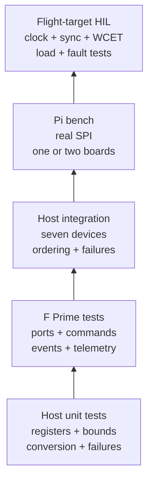

# Testing

The verification strategy deliberately separates evidence that can be established on a host from claims that require the integrated deployment and real electrical interfaces.



## Host unit and integration tests

The host suite compiles the hardware-independent core with C++11, warnings enabled, and an in-memory ADXL355 register/SPI emulator.

```sh
cmake -S libraries/fprime-adxl355/tests -B /tmp/adxl355-host-tests -G Ninja
cmake --build /tmp/adxl355-host-tests
ctest --test-dir /tmp/adxl355-host-tests --output-on-failure
```

Unit coverage includes command-byte encoding, identity validation, signed 20-bit decoding, SI scaling by range, temperature conversion, reset timeout behavior, board synchronization programming, readback verification, SPI errors, safe full and runtime reconfiguration failure, FIFO marker validation, offsets, activity, interrupts, self-test bits, and argument validation.

The integration executable creates seven independent SPI emulators and seven `Device` objects. It verifies all-device initialization, a common timestamp and sequence, fixed read order, valid masks, partial success after one sensor failure, and rejection of an eighth sensor.

## F Prime component tests

From this library root, activate the consumer's F Prime 3.5.1 Python toolchain
and build the checked-in standalone consumer (no workspace sandbox required):

```sh
cmake -S tests/fprime-consumer -B /tmp/adxl355-components -G Ninja \
  -DFPRIME_FRAMEWORK_PATH=/absolute/path/to/fprime
cmake --build /tmp/adxl355-components \
  --target Adxl355_Manager_ut_exe Adxl355_Application_ut_exe
/tmp/adxl355-components/bin/$(uname)/Adxl355_Manager_ut_exe
/tmp/adxl355-components/bin/$(uname)/Adxl355_Application_ut_exe
```

The workspace sandbox also works when its `library_locations` points to
`../../../libraries/fprime-adxl355`.

The manager tests exercise FPP configuration/read ports, control commands, snapshot telemetry, the standard SPI-port adapter, and edge-limited high-rate errors. The application tests exercise seven-port fan-out, internal- and external-clock initialization, all-manager initialization with a partial mask, frame aggregation, disabled acquisition, incomplete-frame event suppression, and recovery reporting.

These generated harnesses have passed with the pinned CubeSpec F Prime 3.5.1
toolchain, but they are not yet part of `.github/workflows/adxl355.yml`. Run
them before integration changes are accepted, and add a workflow job when the
enclosing repository has a stable F Prime/submodule bootstrap path.

## Documentation tests

Run the source-level documentation checks and a strict MkDocs render from the repository root:

```sh
python3 libraries/fprime-adxl355/tests/DocumentationTests.py
uv run --with 'mkdocs==1.6.1' \
  --with 'mkdocs-material==9.7.1' \
  mkdocs build --strict \
  --config-file libraries/fprime-adxl355/mkdocs.yml \
  --site-dir /tmp/adxl355-mkdocs-site
```

Alternatively, install `requirements-docs.txt` in a virtual environment and run `mkdocs build --strict` from `libraries/fprime-adxl355`.

## Requirements traceability and analysis

The [requirements and verification matrix](requirements-and-verification.md) maps stable library requirement IDs to named host tests, generated F Prime tests, inspection evidence, and open HIL work. Update that page in the same change whenever behavior or tests change.

The host core is compiled with `-Wall -Wextra -Werror -pedantic`. The ADXL355
workflow also runs address/undefined-behavior sanitizers and `clang-tidy`, and
enforces an 80% production line-coverage gate. The current host audit covers
473 of 548 production lines (86.3%); CI retains its own XML report for each
workflow run. Coverage is supporting evidence: reviewers must still assess
state transitions, fault paths, timing, and requirement coverage.

The CI static-analysis gate is configured, but local `clang-tidy` execution
remains open because the tool was unavailable on the review host. Retain a
successful CI report before closing that evidence item. Likewise, physical
Raspberry Pi and flight-target HIL remain open until their identified as-run
records have been captured and reviewed.

## Hardware-in-the-loop acceptance plan

Emulator tests do not prove electrical timing. Before flight use, run an HIL test with the R10 board and flight SPI implementation:

1. Validate device IDs and revision from every CS independently.
2. Capture the clock, sync, CS, SCLK, MOSI, and MISO signals for at least several frames.
3. Measure worst-case acquisition duration under flight CPU load; require margin below 250 microseconds.
4. Apply the same static acceleration to all sensors and compare sequence-aligned results.
5. Disable or corrupt one CS and verify only its bit clears while the other samples continue.
6. Stop the 1.024 MHz clock and verify the platform health monitor detects the stalled data path.
7. Exercise reset, reinitialization, and recovery without power cycling.
8. Run long enough to bound FIFO/status overruns and frame-sequence gaps.

For calibrated science use, add sensor-specific scale, bias, axis alignment, temperature, and cross-axis acceptance tests above this transport library.

Passing host and component tests does not close this HIL plan. Archive signal captures, measured worst-case timing, exact software/hardware versions, command/event/telemetry logs, and fault-injection results with the CubeSpec release evidence.

The workspace-level path correction is retained in
[workspace-registration.patch](workspace-registration.patch), because the workspace
and moved sandbox have no Git repository. It has already been applied locally;
other workspace copies can apply it from `FlightSoftware` with `git apply`.
