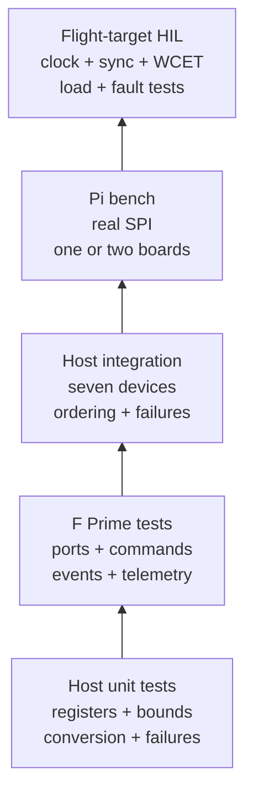

# Testing

The verification strategy deliberately separates evidence that can be established on a host from claims that require the integrated deployment and real electrical interfaces.



## Host unit and integration tests

The host suite compiles the hardware-independent core with C++11, `-Wall -Wextra -Werror -pedantic`, and an in-memory ADXL355 register/SPI emulator. The emulator follows the data sheet: writable bit masks per register, `DATA_RDY`/`FIFO_OVR`/activity cleared by a STATUS read, shadow trim registers reloaded by a software reset (with an injectable bad load), stuck-low and stuck-high MISO, ignored writes, and scripted temperature tearing.

```sh
cmake -S libraries/fprime-adxl355/tests -B /tmp/adxl355-host-tests -G Ninja
cmake --build /tmp/adxl355-host-tests
ctest --test-dir /tmp/adxl355-host-tests --output-on-failure
```

Three executables run:

- `adxl355-unit-tests` covers command-byte encoding, identity validation, signed 20-bit decoding, SI scaling by range, status-checked freshness and plausibility, temperature conversion, tear rejection and plausibility, bounded reset polling, the NVM shadow-register check, board synchronization programming, every programming and readback failure after reset, lifecycle transitions, FIFO bounds and markers, runtime controls, self-test tracking, and argument validation.
- `adxl355-integration-tests` creates seven independent emulators and `Device` objects behind the portable `SynchronizedArray`. It verifies all-device initialization, a common timestamp and sequence, fixed read order, valid masks, and fault containment for failed, stopped, and stale sensors.
- `adxl355-gate-tests` verifies the `AccessGate` contract, including a two-thread test that no two owners ever overlap, and the `ReportQueue` contract: order, drops when full, wrap-around, and a two-thread test that every record arrives intact and in order or is counted as dropped.

## F Prime tool chain

Component tests and deployments need the Python tools pinned by the F Prime checkout at
the tested revision, `35d4c0e881482adf372b8eee3eb56ad2dee74618` (v4.2.0-267), the same revision fprime-csp-libparam and the
TE0715 Zephyr workspace use. In the CubeSpec workspace, create that environment with:

```sh
tools/workspace/bootstrap-fprime-venv.sh --fprime /absolute/path/to/fprime --venv .venv-fprime
. .venv-fprime/bin/activate
```

Outside the workspace, the equivalent is:

```sh
python3 -m venv .venv-fprime && . .venv-fprime/bin/activate
python -m pip install -r /absolute/path/to/fprime/requirements.txt
# macOS only: the pinned CMake 3.26.0 fails inside F Prime's build on macOS 27,
# so remove it and use a newer host CMake (for example from Homebrew).
python -m pip uninstall -y cmake
```

This revision pins fpp 3.3.0a12, which has native builds for Linux (x86_64 and aarch64)
and macOS (arm64 and x86_64), so every host runs the same fpp release natively. The
bootstrap script also handles older F Prime checkouts whose fpp has no native build for
the host, by installing that release's platform-independent (JVM) wheels. If a macOS
link fails with `tapi error: malformed file`, the selected Xcode is older than the
default SDK: update Xcode, or select the matching Command Line Tools with
`sudo xcode-select -s /Library/Developer/CommandLineTools`.

## F Prime component tests

From this library root, with that environment active, build the checked-in standalone consumer (no workspace sandbox required):

```sh
cmake -S tests/fprime-consumer -B /tmp/adxl355-components -G Ninja \
  -DFPRIME_FRAMEWORK_PATH=/absolute/path/to/fprime
cmake --build /tmp/adxl355-components \
  --target Adxl355_Manager_ut_exe Adxl355_Application_ut_exe
/tmp/adxl355-components/bin/$(uname)/Adxl355_Manager_ut_exe
/tmp/adxl355-components/bin/$(uname)/Adxl355_Application_ut_exe
```

The manager tests drive only ports and commands: configuration and reads, every control command, validation errors that must not count as faults, throttled high-rate failure edges published only by `schedIn` (including edges dropped beyond the queue), stuck-bus and stale-data rejection, failed initialization and self-test, NVM mismatch, and snapshot/acquisition independence. The gate is exercised deterministically by re-entering the component from the SPI callback while a command owns it: the high-rate read must return `BUSY` at once, every other command and port must report `BUSY` after a bounded wait without changing device state, and `schedIn` must publish at once.

The application tests exercise seven-port fan-out, internal- and external-clock initialization, partial initialization, frame aggregation, disabled acquisition, the enabled-state reconfiguration interlock, throttled events from an intermittent sensor published by `schedIn`, immediate throttle clearing, frame edges dropped beyond the queue, `schedIn` publishing while a frame owns the gate, overlapping triggers that must be skipped and leave a sequence gap, commands rejected while initialization owns the gate, and edge-detection restart.

The workflow job `fprime-components` checks out F Prime at the tested revision, runs both executables with coverage instrumentation, and enforces a line-coverage gate on `Adxl355/Manager`, `Adxl355/Application`, and `Adxl355/Platform`.

## Static analysis

`clang-tidy` runs the `clang-analyzer-*` checks with warnings as errors (`.clang-tidy`). Use the host build's compilation database for the portable core and the F Prime consumer build's for the components:

```sh
cmake -S tests -B build-static -G Ninja -DCMAKE_EXPORT_COMPILE_COMMANDS=ON
clang-tidy --warnings-as-errors='*' -p build-static \
  Adxl355/Device/Device.cpp Adxl355/Device/AccessGate.cpp Adxl355/Array/SynchronizedArray.cpp
clang-tidy --warnings-as-errors='*' -p /tmp/adxl355-components \
  Adxl355/Manager/Manager.cpp Adxl355/Application/SynchronizedApplication.cpp Adxl355/Platform/OsDelay.cpp
```

Use a `clang-tidy` at least as new as the platform SDK (on macOS, a current Homebrew `llvm`). An older one fails while parsing system headers: Homebrew LLVM 18, for example, cannot parse the macOS 27 SDK even when pointed at its own libc++. Linux CI uses the distribution's `clang-tidy`.

## Documentation tests

Run the source-level documentation checks and a strict MkDocs render from the repository root:

```sh
python3 libraries/fprime-adxl355/tests/DocumentationTests.py
uv run --with 'mkdocs==1.6.1' \
  --with 'mkdocs-material==9.7.1' \
  mkdocs build --strict \
  --config-file libraries/fprime-adxl355/mkdocs.yml \
  --site-dir /tmp/adxl355-mkdocs-site
```

Alternatively, install `requirements-docs.txt` in a virtual environment and run `mkdocs build --strict` from `libraries/fprime-adxl355`.

## Retained evidence

`docs/evidence/` holds the executed results: host tests, sanitizers, host and component coverage, F Prime component tests, static analysis, and documentation checks. `source-sha256.json` records the hash of every source, test, and build file those results were produced from. `python3 tests/check_evidence.py` fails if any recorded file has changed since, so stale evidence cannot pass review silently. After changing code, rerun the suites, refresh the evidence files, and regenerate the manifest with `python3 tests/check_evidence.py --update`.

Coverage numbers belong in the evidence files and CI reports, not in prose. Coverage is supporting evidence: reviewers must still assess state transitions, fault paths, timing, and requirement coverage.

## Requirements traceability and analysis

The [requirements and verification matrix](requirements-and-verification.md) maps stable library requirement IDs to named host tests, generated F Prime tests, inspection evidence, and open HIL work. Update that page in the same change whenever behavior or tests change.

The workflow also runs address/undefined-behavior sanitizers over the host tests. Before the move to F Prime `35d4c0e`, the first remote run to pass every job was [run 36331079661](https://github.com/SiboVG/CubeSpec_FlightSoftware/actions/runs/36331079661) on commit `354b404` (2026-09-27). The first remote attempt, [run 36330821542](https://github.com/SiboVG/CubeSpec_FlightSoftware/actions/runs/36330821542), failed only while installing the component job's dependencies (a conflicting `gcovr` pin), which that commit fixed. CI logs expire, so `docs/evidence/` remains the retained record. Physical Raspberry Pi and flight-target HIL remain open until their identified as-run records have been captured and reviewed.

## Hardware-in-the-loop acceptance plan

Emulator tests do not prove electrical timing. Before flight use, run an HIL test with the R10 board and flight SPI implementation:

1. Validate device IDs and revision from every CS independently.
2. Capture the clock, sync, CS, SCLK, MOSI, and MISO signals for at least several frames.
3. Measure worst-case acquisition duration (seven 14-byte reads) under flight CPU load; require margin below 250 microseconds.
4. Apply the same static acceleration to all sensors and compare sequence-aligned results.
5. Disable or corrupt one CS and verify only its bit clears, with `STALE_DATA` or `IMPLAUSIBLE_DATA`, while the other samples continue.
6. Stop the 1.024 MHz clock and verify every sensor reports `STALE_DATA` and the platform health monitor reacts.
7. Stop the synchronization pulses and verify the platform timing monitor detects it; the sensors keep running on the last pulse.
8. Confirm STATUS bits 7:5 read 0 and `DATA_RDY` clears on a STATUS read on the flight silicon (ADXL-INT-008).
9. Exercise reset, reinitialization, and recovery without power cycling, and read the shadow registers after each reset.
10. Run long enough to bound sequence gaps and `SkippedTriggers`.

The TE0715 sensor bench (ZephyrOSTe0715 repository, `docs/tests/adxl355.md`) runs the manager and the synchronized application unchanged on a Zynq-7000 with Zephyr's SPI driver, against one ADXL355 on its internal clock, with a timing thread in place of the FPGA source. Its test cases cover steps 1, 2 (without the clock and synchronization signals), 6 (no external clock), 8 and 9 for one sensor, plus self test, temperature, six orientations and link faults. The external-synchronization, seven-sensor and flight-load steps stay open.

For calibrated science use, add sensor-specific scale, bias, axis alignment, temperature, and cross-axis acceptance tests above this transport library.

Passing host and component tests does not close this HIL plan. Archive signal captures, measured worst-case timing, exact software/hardware versions, command/event/telemetry logs, and fault-injection results with the CubeSpec release evidence.
